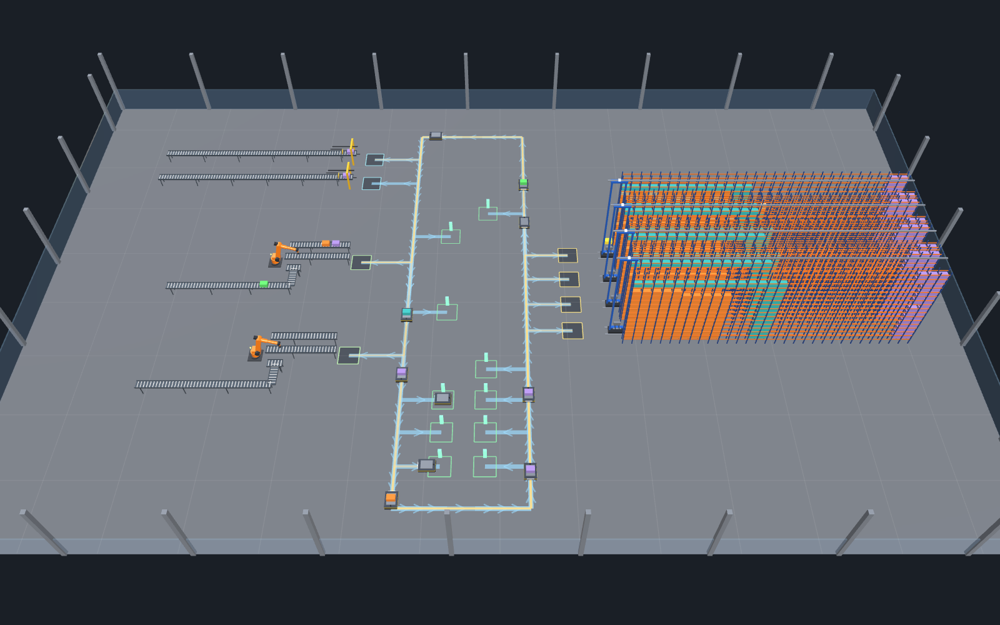
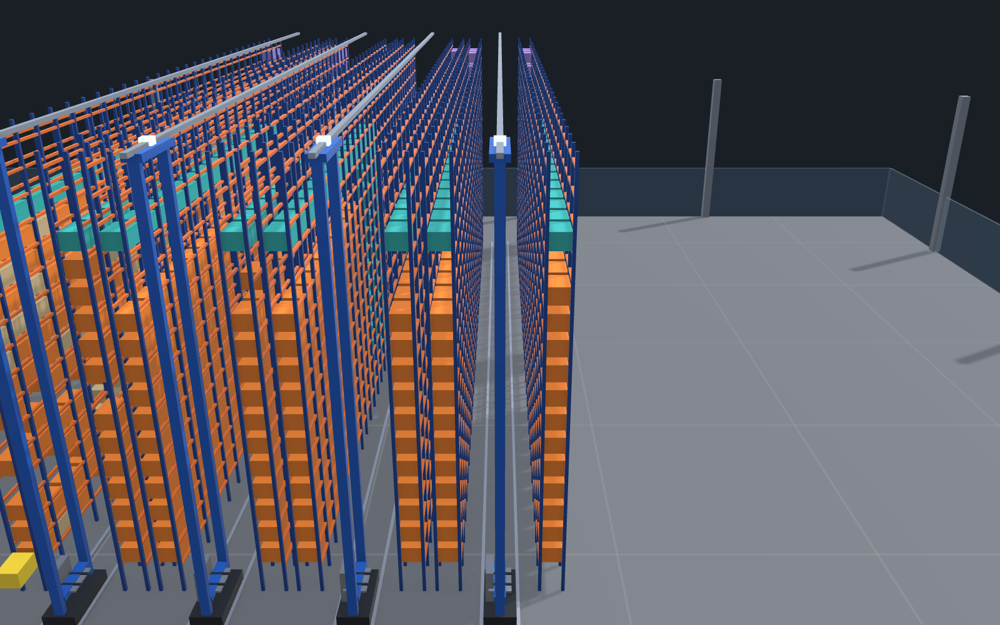
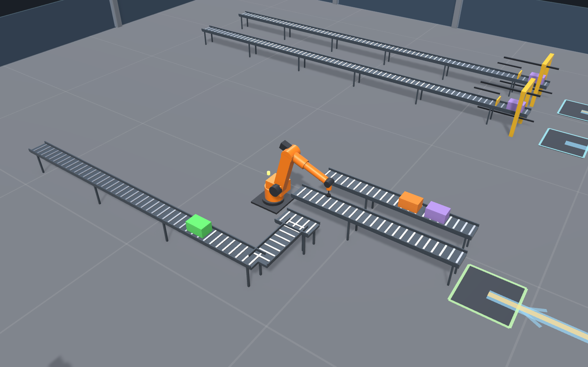
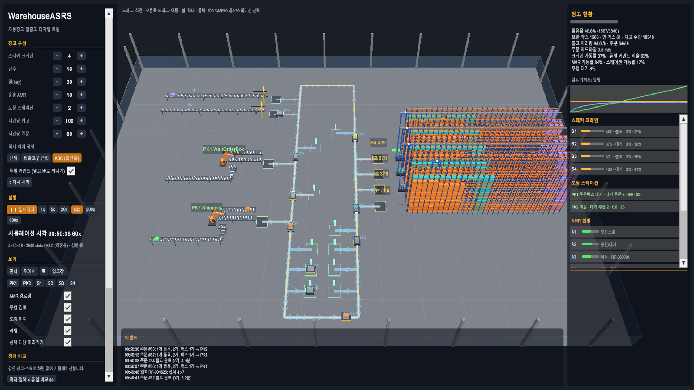

# Unity-WarehouseASRS

Automated warehouse inbound/outbound digital twin in Unity 6 (URP): RFID boxes, fork loaders, AMRs, mini-load ASRS stacker cranes
and a 6-axis picking robot with a suction gripper.

- **Inbound**: boxes with an RFID tag (SKU + quantity) arrive on a roller conveyor; a fork loader (pusher) slides them onto an AMR.
- **AMRs**: one box per AMR, one-way ring with dead-end docks, node/zone reservation, Dijkstra routing, deadlock detection,
  battery and charging pads. The AMR drops the box in the stacker's inbound queue and moves on (charging, parking, inbound or outbound).
- **Stacker cranes (mini-load ASRS)**: 4 aisles x 2 rack rows x 30 bays x 16 levels = 3,840 slots, 8 m high. Trapezoidal x/y travel,
  telescopic fork, in/out queues, **dual-command cycles** (store, then retrieve on the way back). The WMS keeps a slot state machine
  (Free / ReservedIn / Stored / ReservedOut) and three slot policies: Random, Nearest, ABC (fast movers close to the I/O point).
- **Outbound**: random orders (1-3 SKUs). The crane puts the boxes in the out queue, AMRs take them to a packing station where a
  **6-axis robot** (analytic IK) picks item by item into an empty order box. Left-over items go back into storage.
- **Empty boxes** are flagged and stored in the stacker nearest the inbound dock.
- **Full / empty handling**: inbound stops when the warehouse is full (hysteresis 92 % / 85 %); orders wait for the next inbound when stock runs out.
- **UI Toolkit (KO/EN)**: configuration, run speed up to 600x, KPIs and history graph, stackers / stations / AMRs lists, click any box to see its RFID, SKU, quantity and slot.
- **Headless deterministic simulation** (0.1 s step, ~25,000x real time): `wa_sim_run`, `wa_compare`, `wa_check` (invariants).

| | |
|---|---|
|  |  |
|  | |

## Results (seed 1, 4 stackers 30x16, 10 AMRs, 2 stations, 24 h)
57.9 orders/h shipped at 60/h demand, 7 min lead time, crane utilisation 32 % (69 % dual-command), AMR 74 %; invariants hold, full-stop / resume cycle verified.
The bottleneck is the AMR / station flow rather than the cranes, so the slot policies differ little in throughput (see `Docs/BuildFromScratch.md`).

## Run it
1. Unity 6000.6.3f1 with the URP template, package `com.unity.pipeline` 0.8.0-exp.1 (already in `Packages/manifest.json`).
2. Open the project, run `unity command wa_setup_scene` (or open `Assets/WarehouseASRS/Scenes/WarehouseASRS.unity`) and press Play.
3. CLI examples: `unity command wa_sim_run --hours 24`, `wa_compare --hours 12`, `wa_check --hours 24`, `wa_camera --preset racks`, `wa_capture --name shot`.

Everything is procedural (primitives, merged meshes, GPU-instanced boxes); no external assets are needed except the Noto Sans KR font used by the UI.
Build log and design notes: [Docs/BuildFromScratch.md](Docs/BuildFromScratch.md).
